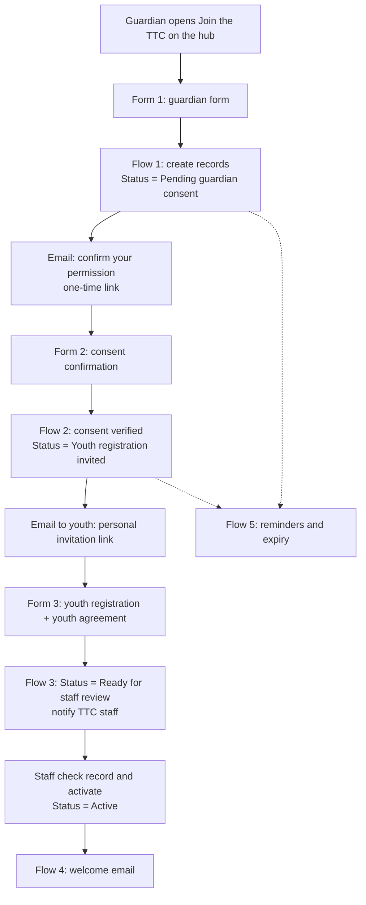

# TTC membership setup: Salesforce side (Option A)

**Status: draft for the VoS Salesforce administrator and leadership. Nothing here has been built in Salesforce yet.**

This guide covers the parent or guardian first membership process on the Teen Tech Centre Hub
(`#join`). The website is the front door only. Salesforce holds every record, sends every email
and decides every status. The website never receives, stores or shows membership, guardian or
youth information.

The field names, flows and wording below are suggestions. The Salesforce administrator should adapt
them to how VoS's Salesforce is already set up (for example, existing Contact, Household,
Program Engagement or Nonprofit Cloud objects), and VoS must approve all wording before go-live.

---

## 1. The process

| Status (shown to families) | Internal status | Set by |
|---|---|---|
| Pending guardian consent | Pending guardian consent | Flow 1, when the guardian form is submitted |
| Youth registration invited | Youth registration invited | Flow 2, only after consent is verified |
| (still "Youth registration invited" to families) | Ready for staff review | Flow 3, when the youth submits |
| Active | Active | A staff member, by hand |
| | Expired / Withdrawn / Inactive | Flow 5, or staff |

A youth cannot create an active membership from the hub. The sign-in tablet only records visits.

---

## 2. Records and fields (suggested)

Use existing VoS objects where they fit. One record per membership, linked to two Contacts.

**Youth Contact** and **Guardian Contact**: use the existing Contact setup. Link them with the
relationship VoS already uses (Household, Relationship or Affiliation).

**TTC Membership** (new custom object, or fields on an existing program enrolment object):

| Field | Type | Notes |
|---|---|---|
| Youth | Lookup (Contact) | |
| Guardian | Lookup (Contact) | |
| Status | Picklist | Pending guardian consent, Youth registration invited, Ready for staff review, Active, Expired, Withdrawn, Inactive |
| Consent token | Text (hidden, unique) | Long random value. Never the record ID. |
| Consent token expires | Date/Time | For example, 7 days after the request |
| Consent requested | Date/Time | |
| Consent confirmed | Date/Time | Set by Flow 2 |
| Consent confirmed by | Text | The guardian's name as typed on Form 2 |
| Consent wording version | Text | For example "TTC-consent-2027-01". Store the version the guardian saw. |
| Consent items | Multi-select or checkboxes | Membership; arrive and leave on own during open hours with sign-in and sign-out; program messages through the approved channel; emergency contact provided |
| Guardian authorized to consent | Checkbox | From Form 1. On its own this is NOT verification. |
| Youth invite token | Text (hidden, unique) | Long random value, single use |
| Youth invite expires | Date/Time | |
| Youth agreement accepted | Date/Time | From Form 3 |
| Youth agreement version | Text | |
| Media consent | Picklist | Yes / No / Not answered. Optional. Never a condition of membership. |
| Activated by | Lookup (User) | Set when staff activate |
| Activated on | Date/Time | |

Field-level security: only TTC staff and admins can see these records. Tokens are hidden from
page layouts.

---

## 3. Forms (in the approved form tool)

Use a form tool that connects to Salesforce and that VoS has approved (for example, one already
licensed, or Salesforce Experience Cloud with screen flows). Whichever is chosen:

- It runs on its own secure (https) address. Add that address to `join.approvedFormHosts` in the
  hub's `js/config.js`.
- It writes to Salesforce through its own approved connection. No passwords, API tokens or client
  secrets ever go in the hub's files, which are public.
- It must work well on phones.

**Form 1: parent or guardian form** (link on the hub's Join the TTC page)

Ask only what's needed to identify the youth and reach the guardian:
- Youth first and last name, date of birth
- Guardian first and last name, email, phone, relationship to the youth
- "I am the youth's parent or legal guardian, or I am otherwise authorized to give permission" (checkbox)
- The consent items, with the approved wording shown in full before submitting
- Emergency contact (if VoS decides to collect it here rather than in Form 3)

Show the participation and privacy information before the submit button.
After submit, send the guardian to: `https://vosttc.github.io/VOSteentechcentre/#join-thanks`

**Form 2: consent confirmation** (opened only from the email link)
- Reads the consent token from the link into a hidden field (if the tool supports prefilling hidden
  fields from the link).
- Shows the youth's first name and the consent wording again, then "I confirm I give permission" and
  the guardian types their name.
- Flow 2 checks the token before anything changes.

After submit, send them to: `https://vosttc.github.io/VOSteentechcentre/#join-confirmed`

**Form 3: youth registration** (opened only from the youth's invitation link)
- Reads the youth invite token from the link into a hidden field.
- The youth fills in their own details (as VoS decides: school, grade, pronouns, accessibility
  needs, and so on).
- Optional photo and video choice, as its own question.
- The TTC community agreements, with "I agree" as a separate step.

After submit, send them to: `https://vosttc.github.io/VOSteentechcentre/#join-complete`

These return pages show general next steps only. They don't read anything from the link and never
show names.

---

## 4. Flows

**Flow 1: guardian form received** (record-triggered, on create)
1. Find or create the Guardian and Youth Contacts. Check for duplicates first.
2. Create the TTC Membership: Status = Pending guardian consent.
3. Generate the consent token and set it to expire in 7 days.
4. Email the guardian the consent request (template A) with the link to Form 2 carrying the token.

**Flow 2: consent confirmation received**
1. Find the membership by consent token.
2. Stop, and send nothing, if there's no match, the token has expired or was already used, or the
   status isn't Pending guardian consent. Log the attempt for staff.
3. Otherwise set Consent confirmed, Consent confirmed by and Consent wording version, and clear the
   consent token so it can't be reused.
4. Set Status = Youth registration invited.
5. Generate the youth invite token (expires in 14 days) and send the youth the invitation
   (template B). Send it to the youth's email if VoS collects one, or to the guardian to pass on.
   VoS decides whether invitations can also go through the approved WhatsApp channel.

**Flow 3: youth registration received**
1. Find the membership by youth invite token. Use the same checks as Flow 2.
2. Save the youth's details, media consent and Youth agreement accepted. Clear the token.
3. Set Status = Ready for staff review and notify TTC staff (email, task or Chatter post).

**Flow 4: staff activation**
- A staff member opens the "Ready to activate" list view, checks the record and uses an "Activate"
  quick action. It sets Status = Active, Activated by and Activated on, and sends the welcome email
  (template C).
- Only TTC staff with the right permission can activate.

**Flow 5: reminders and expiry** (scheduled, daily)
- Pending guardian consent for 3 days: one reminder to the guardian.
- Consent token expired: Status = Expired. Staff can restart it.
- Youth registration invited for 7 days: one reminder.

---

## 5. Staff views

Create list views or reports, then paste their links into `join.staffLinks` in the hub's
`js/config.js`. They show up as buttons in Staff tools > Overview. Salesforce asks staff to log in;
the hub only holds the links.

- Pending guardian consent
- Ready to activate
- All TTC memberships

---

## 6. Email drafts (placeholders, need VoS review)

**A. To the guardian: please confirm your permission**

> Subject: Please confirm [Youth first name] can join the Teen Tech Centre
>
> Hi [Guardian first name],
>
> Thanks for starting a Best Buy Teen Tech Centre membership for [Youth first name]. To finish this
> step, please confirm your permission:
>
> [Confirm my permission]
>
> This link works once and expires on [date]. If you didn't request this, you can ignore this email.
>
> Visions of Science, Best Buy Teen Tech Centre
> Daniels Spectrum, Room 210

**B. To the youth: your invitation to register**

> Subject: You're invited to finish joining the Teen Tech Centre
>
> Hi [Youth first name],
>
> Your parent or guardian has given permission for you to join the Best Buy Teen Tech Centre.
> Finish your registration here:
>
> [Finish my registration]
>
> This link is just for you and expires on [date].

**C. Welcome**

> Subject: Welcome to the Teen Tech Centre
>
> Hi [Youth first name],
>
> Your membership is active. Drop in Tuesday to Friday 2:00 to 7:00 PM and Saturday 3:00 to
> 7:00 PM. Sign in at the front tablet when you arrive and sign out when you leave.
> [Hours from the TTC Weekly Schedule. Confirm before sending.]

---

## 7. Security rules

- Links in emails carry random, single-use, expiring tokens, never Salesforce record IDs or names.
- Nothing in the hub's code or settings is secret. Never add credentials there.
- Only https form addresses on the approved list are used by the hub.
- Store the consent wording version with every consent.
- Only staff who need TTC membership records can see them (VoS 6.4, Pt 2 12.1).
- Build and test in a Salesforce sandbox with made-up test people first. Never use real youth data
  for testing.

---

## 8. Hub settings (`js/config.js`, `join` section)

| Setting | When to set it |
|---|---|
| `approvedFormHosts` | When the form tool is chosen, for example `["yourorg.tfaforms.net"]` |
| `guardianFormUrl` | When Form 1 is approved and tested |
| `embed` | `true` only if the form tool supports embedding and it works on phones; otherwise a button opens it |
| `staffLinks` | When the list views or reports exist |
| `showReviewNotes` | `false` once VoS approves all wording |

Staff tools > Overview shows a checklist of these.

---

## 9. Decisions needed before go-live

1. Which approved form tool connects to VoS's Salesforce, and any licence cost.
2. How consent is verified: an email confirmation link (as above) or an e-signature.
3. Which Salesforce object holds TTC memberships.
4. Approved wording: consent, privacy statement (retention, privacy contact), media consent, youth
   agreement, emails.
5. Whether 18-year-olds give their own consent (open item in TTC 3.1).
6. Where youth invitations go: youth email, guardian email, or the approved WhatsApp channel.
7. Whether attendance moves into Salesforce (TTC 3.1 open item).
8. Retiring the old youth Google Form.
9. Updating TTC 3.1 in the policy manual to describe the guardian first process.
